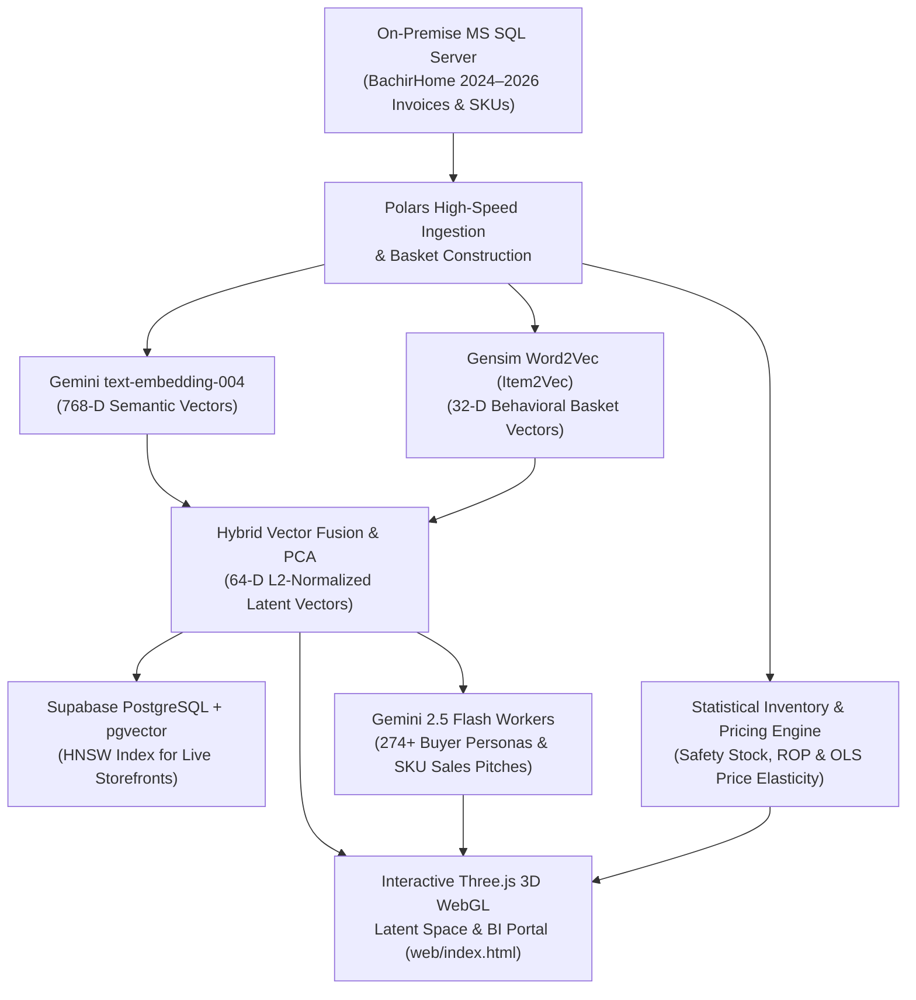

# RecoSys — AI Vector Recommendation, Customer Persona & Predictive Inventory Engine

An end-to-end **Machine Learning, Google Gemini LLM Merchandising & Statistical Inventory Intelligence Pipeline** paired with an interactive **Three.js 3D WebGL Latent Space Explorer** (`web/index.html`).

Built for **B HOME (Bachir Home)** to transform multi-year MS SQL Server ERP transaction history (**2,166 SKUs** and **274+ commercial accounts** across `BachirHome_2024–2026`) into automated e-commerce product recommendations, AI buyer personas, and statistical procurement alerts.

---

## 🎯 Business Problems Solved

1. **Cross-Selling & Personalized Storefront Shelves**: Traditional wholesale and DTC catalogs show static lists. `recosys` powers live *"For You"*, *"Trending Now"*, and *"Don't Miss Out (Peer Lookalikes)"* shelves in production by fusing semantic product meaning with real purchase basket co-occurrence.
2. **Actionable Sales Rep & Merchandising Intelligence**: Synthesizes custom **Gemini 2.5 Flash Buyer Personas** and actionable sales pitches for every commercial account and catalog SKU.
3. **Scientific Inventory Replenishment & Pricing**: Replaces gut-feel purchasing with statistical **Reorder Point ($ROP$)**, **Safety Stock breach alerts**, **12-Month Seasonal Velocity Indices**, and **Log-Log OLS Price Elasticity of Demand (PED)**.

---

## 🏗️ Pipeline Architecture



---

## ✨ Key Capabilities & 5-Tab Intelligence Portal

1. **`🌐 3D Universe` (Three.js WebGL Manifold)**:
   - Interactive 3D visualization of **2,440+ items and commercial buyer accounts** in **t-SNE** and **PCA** space across 8 Gemini-named merchandising clusters.
   - Clicking any account renders live 3D vector beams to their top-5 lookalike peers and personalized product recommendations.
2. **`🎯 Customer Recs & AI Buyer Personas`**:
   - Displays each account's **Gemini 2.5 Flash Buyer Persona**, **Sales Rep Action Guidance**, Direct Personalized Recommendations (exponential time-decay basket profiling), and Peer Collaborative Recommendations.
3. **`👥 Lookalike Matrix`**:
   - Cosine-similarity peer matching to identify untapped cross-sell opportunities across similar retail/hospitality buyers.
4. **`📦 Inventory, Safety Stock & Statistical ROP`**:
   - Computes statistical Safety Stock and Reorder Points:
     $$ROP = \mu_d \cdot L + Z \cdot \sigma_d \sqrt{L}$$
   - Automated stock health flags (`CRITICAL_SAFETY_BREACH`, `REORDER_NOW`, `OVERSTOCKED`, `OK`) + **Log-Log OLS Price Elasticity** (`statsmodels`) classification.
5. **`📈 Seasonality & Demand Forecasting`**:
   - 12-month and 4-season velocity index tracking (`PEAK_DEMAND`, `HIGH_DEMAND`, `LOW_SEASON`).

---

## 🛠️ Tech Stack

* **Data & ML Pipeline (Python 3.11)**: `Polars`, `PyArrow`, `NumPy`, `SciPy`, `Scikit-Learn` (PCA, t-SNE, K-Means), `Gensim` (Word2Vec / `Item2Vec`), `PyTorch`, `Statsmodels` (Log-Log OLS), `USearch` (HNSW ANN), `FastAPI`
* **AI Models**: Google Gemini `text-embedding-004` (768-D embeddings) & `gemini-2.5-flash` (multi-threaded persona & merchandising generation with Parquet caching)
* **Databases**: MS SQL Server (`pyodbc` / `SQLAlchemy`), Supabase PostgreSQL (`pgvector` HNSW), SQLite
* **3D Visualization Frontend**: Three.js (`r128` WebGL), `OrbitControls`, `Tween.js`, Vanilla JS/CSS

---

## 🚀 Running the Pipeline & 3D Explorer

* **Launch the 3D WebGL Intelligence Portal**:
  Open `web/index.html` directly in any modern browser (customer names in `web/data.js` are anonymized for portfolio demonstration).
* **Run the Full Python ML & Embedding Pipeline**:
  ```bash
  python run_pipeline.py
  ```
